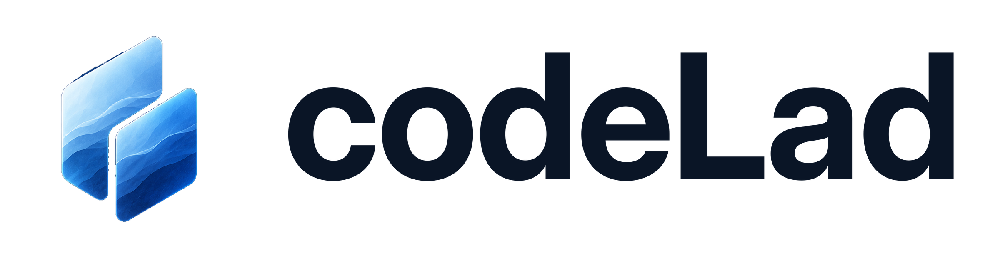

# Codelad

<picture>
  <source media="(prefers-color-scheme: dark)" srcset="assets/codeLad-lockup-dark-transparent-2400.png">
  
</picture>

Codelad is an independently developed, open-source desktop code editor based on VS Code OSS. It preserves the real editor, terminal, debugger, Git tools and extension host while removing first-party telemetry and unnecessary cloud dependencies.

The project is under development. There is no production release yet. Native glass, the code graph and the redesigned developer workspace are planned work; see the [implementation status](docs/codelad/IMPLEMENTATION_STATUS.md) for what actually works and has been tested.

## Branches

- **[`dev`](https://github.com/nibir-ai/codelad/tree/dev)**: ongoing Codelad development. Start changes and open development pull requests here.
- **[`stable`](https://github.com/nibir-ai/codelad/tree/stable)**: reviewed checkpoints promoted from `dev` after their required checks. The initial branch is a bootstrap checkpoint, not a production release.
- `main`: retained upstream starting point. It is not the Codelad development or release branch.

The GitHub fork relationship records our origins. Codelad has its own product decisions and release process. Upstream changes are evaluated and merged deliberately; they are not automatically synchronized. See the [branch and release workflow](docs/codelad/branches.md).

## Privacy

Core telemetry, automatic crash uploads and remote experimentation are disabled. Open VSX is the default extension registry. Automatic updates, Git autofetch, automatic JS/TS type acquisition and remote JSON schema downloads default off. Codelad uses its own profile directories and does not require sign-in.

User-selected extensions, Git remotes, package managers and external integrations can use the network. Codelad is not an extension firewall. Read the [privacy policy and network inventory](docs/codelad/privacy.md) and [executed validation](docs/codelad/HANDOFF.md) for the exact scope and outstanding checks.

## Build and contribute

Use the Node version in [`.nvmrc`](.nvmrc) and the platform prerequisites in the [upstream build guide](https://github.com/microsoft/vscode/wiki/How-to-Contribute). From a clone of this repository:

```sh
git switch dev
npm run install-fast
npm run compile
```

Launch with `scripts/code.bat` on Windows or `scripts/code.sh` on Linux/macOS. For isolated development and validation, use the [repository launch skill](.agents/skills/launch/SKILL.md). Report Codelad issues in [this repository](https://github.com/nibir-ai/codelad/issues).

Focused source-policy checks do not require a full editor build:

```sh
node build/codelad/check-privacy.ts
node --test build/codelad/privacy.test.ts build/codelad/networkAudit.test.ts build/codelad/linuxConnections.test.ts
```

These checks inspect configuration, dependency declarations and capture parsers. They do not establish runtime privacy or release readiness.

## License and origins

Licensed under [MIT](LICENSE.txt). Codelad derives from Microsoft's VS Code OSS source; upstream copyright notices, licenses and third-party notices are retained. Codelad is an independent product and is not an official Microsoft distribution. Included extensions retain their respective licenses and publisher identifiers.
